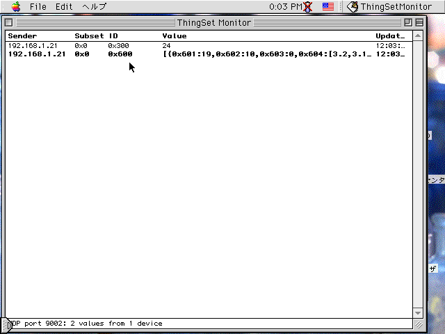
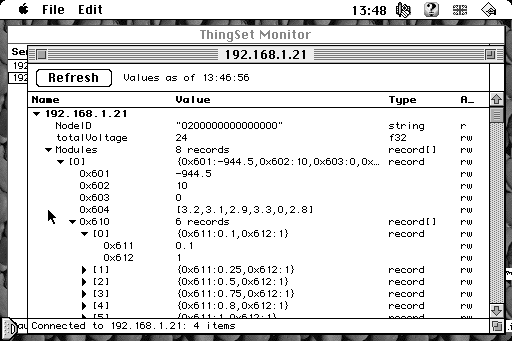

# ThingSetClassic

A [ThingSet](https://thingset.io/) client for 68k and PowerPC Macs with System 7.1+ and OpenTransport, built on
[ThingSet++](https://github.com/Brill-Power/thingsetplusplus).

## Monitor

The monitor window shows the latest values from reports broadcast over UDP (port 9002),
one row per sender and ID:

```text
Sender          Subset  ID           Value                  Updated
10.0.0.5        0x1     0x300        24.5                   11:42:07
10.0.0.5        0x1     0x301        true                   11:42:07
192.168.1.23    0x2     0x700        false                  11:42:05
```



Changed values are shown in bold for a moment. Rows can be selected (shift-click
for a range) and copied as tab-separated text; with nothing selected, Copy takes
the whole table. The status bar shows counts and the latest problem, such as an
undecodable report.

To reduce CPU load on a network with lots of devices, the monitor only listens while
it is the active window; it pauses while another window is in front or the application
is in the background.

## Value Viewer

File > Connect To... (or double-clicking a row in the monitor) opens a window
browsing one device over TCP (port 9001):



## Requirements

Requires a 68030 or later or any Power Mac, System 7.1+ and Open Transport with
TCP/IP. The fat build runs natively on both.

## Building

Needs [Retro68](https://github.com/autc04/Retro68), built with both its 68k and
PowerPC toolchains, and a ThingSet++ checkout (default `../thingsetplusplus`,
override with `-DTHINGSETPP_DIR=...`).

To build a fat application, which runs natively on both 68k and Power Macs:

```sh
cmake -S fat -B build-fat -DRETRO68_TOOLCHAIN=path/to/Retro68-build/toolchain
cmake --build build-fat
```

This produces `build-fat/ThingSetMonitor.bin` (MacBinary) and
`build-fat/ThingSetMonitor.dsk` (an HFS disk image containing the application).

To build for one architecture only, build the top-level project with the
corresponding toolchain file:

```sh
# 68k
cmake -S . -B build \
    -DCMAKE_TOOLCHAIN_FILE=path/to/Retro68-build/toolchain/m68k-apple-macos/cmake/retro68.toolchain.cmake
# PowerPC
cmake -S . -B build-ppc \
    -DCMAKE_TOOLCHAIN_FILE=path/to/Retro68-build/toolchain/powerpc-apple-macos/cmake/retroppc.toolchain.cmake
```

Unless a build type is given, 68k code is built with `-Os` and PowerPC code with
`-O2` (`-Os` currently fails to link against Retro68's PowerPC libstdc++).

## Tests

The report handling and the client can be tested on the host against stub Open
Transport headers. The client test talks to ThingSet++'s own server, with responses
split into small pieces as TCP may deliver them (set `TRACE=1` to see the requests):

```sh
cmake -S tests -B build-tests && cmake --build build-tests && ctest --test-dir build-tests
```

## Limitations

- Enhanced reports (`0x1E`, prefixed with the sender's EUI-64) are noted in the
  status bar but not decoded: ThingSet++'s UDP decoder only expects two top-level elements.
- The monitor shows values by numeric ID; it doesn't use a device's schema for names.
- Host names are looked up synchronously, so the Mac pauses briefly while connecting by name.
- The client is read-only: values can't be changed and functions can't be called.
- Record members are shown by ID (e.g. `0x201`) when the device doesn't name them:
  ThingSet++ answers neither `FETCH` on a record nor `_Metadata` for its members.
- The table holds up to 2000 rows; further new items are ignored until it is cleared.
